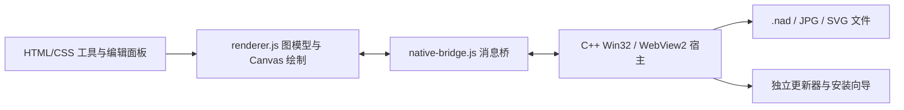

# 程序结构与绘图逻辑

NaDraw 不是全部由 C++ 绘制的界面。Win32 宿主、安装向导、压缩器和更新器使用 C++；HTML/CSS/JavaScript 通过系统 WebView2 提供绘图交互。源码包提供全部这些实现及可编辑 SVG 素材。

## 文件职责

| 文件 | 作用 |
| --- | --- |
| `src/web/index.html` | 工具栏、菜单、教程、弹窗和画布结构 |
| `src/web/styles.css` | 四分区界面、工具状态、面板与编辑器样式 |
| `src/web/renderer.js` | 图模型、操作、撤销、吸附、渲染及导出几何 |
| `src/web/native-bridge.js` | 请求编号、UTF-8 / Base64 消息、异步回复与事件 |
| `src/native/app/main.cpp` | Win32 窗口、WebView2、文件对话框、文件读写及测试入口 |
| `src/native/app/update-client.h` | 后台检查与下载、退出后应用、完成提醒 |
| `src/native/common/update-common.h` | JSON、版本、HTTP、签名、散列、设置与包验证 |
| `src/native/common/update-public-key.h` | 公开的官方发布验签公钥 |
| `src/native/updater/main.cpp` | 独立等待主程序退出、复核并执行安装 |
| `src/native/installer/setup.cpp` | 中文安装向导、暂存/备份/回滚、卸载 |
| `src/native/installer/pack.cpp` | 将 app 目录压缩为 Windows XPRESS_HUFF 载荷 |

## 图模型与键

`state.atoms` 保存原子坐标和标签；`state.bonds` 通过原子 ID 连接，键级是数据字段，不由画面上画了几条线反推；注释、箭头、括号、电荷和文本放在 `decorations`。同一双键的两条显示线共享两个逻辑端点。

`bondVisualSegments` 为单、双、三键生成显示线段。双键无手动布局时，孤立键等长居中；环内通过 `ringPathWithoutBond` 寻找不经过当前键的路径，用路径中心确定内侧；链上按相邻键方向选择较少冲突的一侧。手动 `doubleLayout` 优先于自动布局，只改变显示，不改变连接关系。

双键工具点击已有双键时按 center → left → right 循环；点击其他普通键直接设为双键。单键、三键工具保留原有模 3 累加。`beginBondInteraction` 区分键身与端点，防止较大的端点吸附半径抢占短键主体的点击。

## 化学辅助

`valenceFor` 汇总与原子相连的真实键级。`implicitHydrogens` 按常见元素目标价态和电荷给出显示用氢数。模板也创建同样的 atoms/bonds，因此参与统一计算。

这是一组二维绘图启发式规则，不是完整的化学信息学引擎：不保证覆盖所有离子、芳香性、配位键、自由基、互变异构体或非常规价态。显示提示不能替代专业判断。

## 吸附、拖动与变换

显示坐标由 viewport 的平移和缩放转换为世界坐标。固定键长和 24 方向辅助在世界坐标计算。端点匹配、文字标注锚点、智能辅助线是独立开关。

拖动时保留原操作快照，再计算候选落点和虚影；松开后提交。连接基团的端点吸附可合并两个原子 ID；文字吸附到端点或括号位置，箭头不使用专用文本吸附，但可作为中心对齐参照。选择中的缩放和旋转作用于逻辑对象。

## 文字与导出

元素标签仍是文字数据，可覆盖节点，并按连接方向排布自动补氢；用户编辑后保存覆盖文本。普通文字支持字符输入、颜色、字号，以及 Unicode 上下角标和常用化学符号。

当前编辑器通过可编辑文本和 Unicode 符号实现上下角标，不是支持任意字体、任意字符混合格式的完整富文本排版引擎。画布输出用 Canvas；SVG 输出共享键的几何线段，文字仍以 SVG text/tspan 输出。图片边界按已有内容并留少量边距裁切，不依赖当前视口。

## 文档、历史与文件

每个绘图标签保存独立的图、视口、历史和文件名。撤销采用有限数量的状态快照，保存工程时不写入撤销历史。`.nad` 是可阅读 JSON，格式见 [FILE_FORMAT.md](FILE_FORMAT.md)。

## 更新与安装

官方构建在后台取签名清单和安装包，验证后等待正常退出。独立更新器再次复核，执行安装向导的静默更新。安装先暂存新文件、检测占用，再备份并替换；普通替换失败时回滚。下次启动显示完成提醒。普通源码构建不加入这一官方更新通道。
